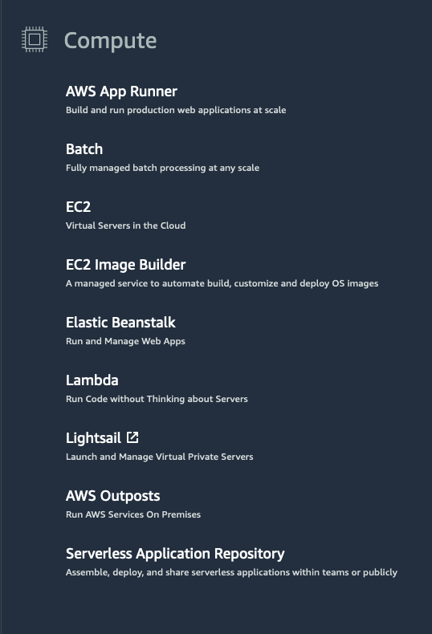

# AWS Compute

## Understanding Servers

A **server** is a computer or collection of computers connected to a network that handles requests from clients and sends responses.

Servers provide resources such as:

- **CPU** – Processes application instructions.
- **Memory** – Stores data needed during processing.
- **Networking** – Enables communication between clients and applications.

Servers commonly handle **HTTP requests** and responses using the **client-server model**.

### Client-Server Model

```text
Client
  │
  │ Request
  ▼
Server
  │
  │ Response
  ▼
Client
```

A client can be a person or a computer that sends a request, while the server processes the request and returns a response.

### Common HTTP Servers

> HTTP server: It is a server that processes HTTP requests and sends HTTP responses.

- **Windows:** Internet Information Services (IIS)
- **Linux:** Apache HTTP Server, Nginx, Apache Tomcat

## AWS Compute Options

AWS provides multiple compute services for running applications.

At a fundamental level, compute options can be divided into:

1. **Virtual Machines**
2. **Container Services**
3. **Serverless**


