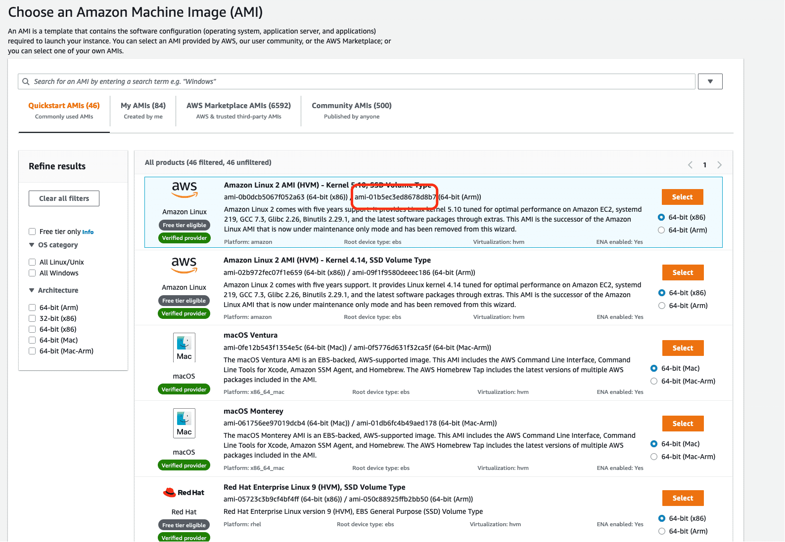
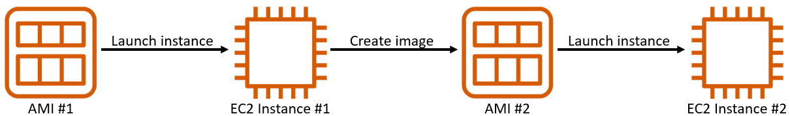
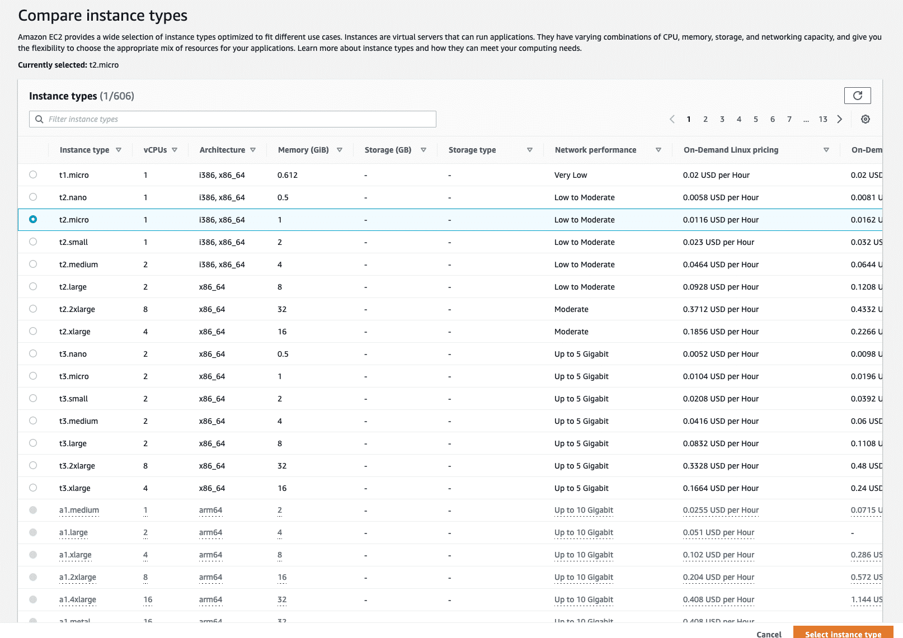
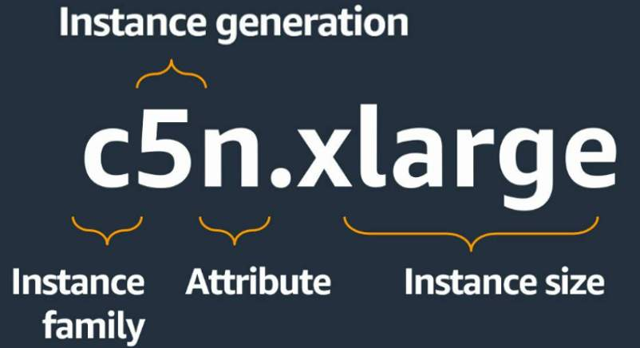
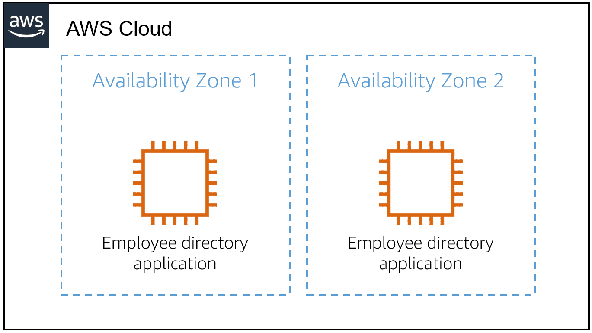
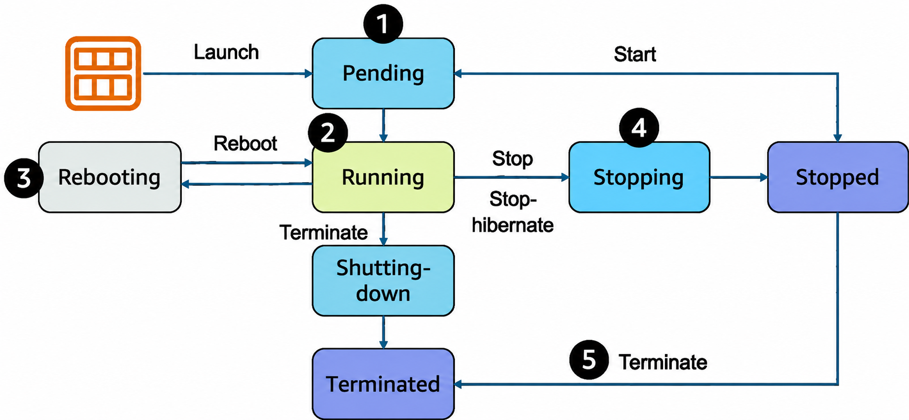

# Virtual Machines

A **virtual machine (VM)** is a **software-based computer** that runs on a physical computer.

It behaves like a real computer and has its own:
- CPU, memory, storage, and network resources.
- Operating system (e.g., Linux or Windows).
- Applications and other software.

A **hypervisor** is software that runs on the physical **host machine** and creates and manages multiple VMs by **allocating and isolating** the host's resources among them.

Each VM works as an **independent machine**, even though multiple VMs may share the same physical hardware.

```
Physical Server (Host)
        │
    Hypervisor
   ┌────┼────┐
   ↓    ↓    ↓
  VM1  VM2  VM3
 Linux Windows Linux
 ```

## Amazon EC2

**Amazon Elastic Compute Cloud (Amazon EC2)** provides virtual servers in the AWS Cloud.

```text
AWS Physical Host
      │
   Hypervisor
      │
      ├── Virtual Machine (EC2)
      │      └── Guest Operating System
      │
      └── Virtual Machine (EC2)
             └── Guest Operating System
```

AWS manages:

- Physical host machines
- Hypervisor layer
- Underlying infrastructure

The EC2 instance runs a **guest operating system**, which is used to run your applications.

> **Key idea:** Amazon EC2 provides virtual machines that give you compute capacity in the AWS Cloud.

Understanding EC2 is important because many other AWS compute services use EC2 or similar virtualization concepts behind the scenes.

With EC2, you can:

- Launch or stop instances when needed.
- Choose the required compute capacity.
- Pay for the capacity you use.
- Manage instances using the AWS Console, CLI, SDKs, and automation tools.

## Creating an EC2 Instance

When launching an EC2 instance, you configure:

- **Hardware** – CPU, memory, network, and storage.
- **Operating System** – Selected using an AMI.
- **Networking** – VPC and Availability Zone.
- **Security** – Firewall rules and authentication.

# Amazon Machine Image (AMI)

An **Amazon Machine Image (AMI)** is a template used to create an EC2 instance.

An AMI can include:

- Operating system
- Storage configuration
- Architecture
- Launch permissions
- Preinstalled software

# Finding AMIs

There are multiple ways to select an AMI:

- **Quick Start AMIs** – Commonly used AMIs created by AWS for quickly launching instances.
- **AWS Marketplace AMIs** – AMIs provided by third-party vendors with open-source or commercial software.
- **My AMIs** – AMIs created from your own EC2 instances.
- **Community AMIs** – AMIs shared by the AWS user community.
- **Custom Image** – Custom Assets built using **EC2 Image Builder**.



```text
AMI
 │
 │ Launch
 ↓
EC2 Instance
 │
 ├── Operating System
 └── Applications
```

> **Key idea:** AMI is the **template**, while an EC2 instance is the **running virtual server created from that template**.

### Reusing an AMI



An AMI can be reused to create multiple EC2 instances with the same configuration.

You can also create an AMI from an existing EC2 instance and use it to launch another instance.

# EC2 Instance Types

An **EC2 instance type** defines the combination of resources available to an instance, such as:

- vCPUs
- Memory
- Networking
- Local storage
- GPUs (for some instance types)



Example:


```text
c5n.xlarge
│││ │
│││ └── Size
││└──── Additional capability
│└───── Generation
└────── Instance family
```

The instance family and size help determine the performance and resources of the instance.

# EC2 Instance Families

Different instance families are optimized for different workloads.

| Family | Purpose | Typical Use |
|---|---|---|
| **General Purpose** | Balanced CPU, memory, and networking | Web servers, applications |
| **Compute Optimized** | High-performance CPU | Batch processing, high-performance applications |
| **Memory Optimized** | Large amounts of memory | Databases, in-memory caches, analytics |
| **Accelerated Computing** | Hardware accelerators such as GPUs | ML, HPC, graphics, scientific workloads |
| **Storage Optimized** | High-performance local storage | NoSQL databases, data warehouses, analytics |
| **HPC Optimized** | High-performance computing | Large simulations, deep learning |

# EC2 Instance Location

An EC2 instance runs inside an **Availability Zone (AZ)** within an AWS Region.

When starting with EC2, AWS can place instances in a **default VPC**.

For production workloads, you can create a **custom VPC** and control networking and access more precisely.

```text
AWS Region
   │
   ├── Availability Zone A
   │      └── EC2 Instance
   │
   └── Availability Zone B
          └── EC2 Instance
```



# EC2 High Availability

A single EC2 instance can become a **single point of failure**.

For higher availability, run multiple EC2 instances across different Availability Zones.

```text
Availability Zone A        Availability Zone B
      │                           │
  EC2 Instance                EC2 Instance
      │                           │
      └──────── Application ──────┘
```

If one instance or Availability Zone has a failure, the other instance can continue serving the application.

> **Key idea:** For high availability, use **multiple EC2 instances across at least two Availability Zones**.

# EC2 Instance Lifecycle

An **EC2 instance lifecycle** describes the different states an EC2 instance goes through from the moment it is created until it is terminated.

<!-- <video controls width="600">
    <source src="../Assets/EC2-LifeCycle.mp4" type="video/mp4">
</video> -->



## 1. Pending

When you **launch** an EC2 instance, it enters the **Pending** state.

During this stage:

- AWS prepares the instance to enter the **Running** state.
- AWS performs the actions required to set up the instance.
- The AMI content is copied to the root device.
- The necessary networking components are allocated.
- **Billing has not started** yet.

```text
Launch
   ↓
Pending
   ↓
Running
```

> **Key idea:** **Pending = EC2 is being prepared to run.**

---

## 2. Running

When an EC2 instance is in the **Running** state, it is ready to use.

This is also the stage where **billing begins**.

From the Running state, you can:

- Reboot the instance
- Stop the instance
- Stop-hibernate the instance
- Terminate the instance

```text
              ┌── Reboot → Rebooting → Running
              │
Pending → Running
              │
              ├── Stop / Stop-hibernate → Stopping → Stopped
              │
              └── Terminate → Shutting-down → Terminated
```

> **Key idea:** **Running = EC2 is active and ready to use.**

---

## 3. Rebooting

**Rebooting** an EC2 instance is similar to rebooting an operating system.

A reboot is different from performing **Stop → Start**.

When an instance is rebooted:

- The instance remains on the same host.
- Its public DNS name (IPv4) remains the same.
- Its private and public IPv4 addresses remain the same.
- An IPv6 address, if applicable, remains on the same host.
- Data on instance store volumes is maintained.

After rebooting, the instance returns to the **Running** state.

```text
Running
   │
   │ Reboot
   ↓
Rebooting
   │
   ↓
Running
```

> **Key idea:** **Reboot = restart the operating system without performing a Stop → Start.**

---

## 4. Stopping

When you stop an EC2 instance, it moves through the **Stopping** state before reaching the **Stopped** state.

```text
Running
   │
   │ Stop / Stop-hibernate
   ↓
Stopping
   ↓
Stopped
```

### Stop

When you **stop** an instance:

- The instance enters **Stopping** and then **Stopped**.
- AWS does not charge instance usage or data transfer fees while the instance is stopped.
- **EBS storage** continues to incur storage charges.
- Some attributes, such as the **instance type**, can be modified while stopped.
- Data in the instance's **RAM is lost**.

> **Key idea:** **Stop = instance shuts down and RAM data is lost.**

### Stop-Hibernate

When you **stop-hibernate** an instance:

- EC2 signals the operating system to perform **hibernation (suspend-to-disk)**.
- The contents of **RAM are saved to the EBS root volume**.
- The instance then reaches the **Stopped** state.
- Hibernation works only when it is enabled and the instance meets the required prerequisites.

```text
Running
   │
   │ Stop-hibernate
   ↓
Stopping
   │
   │ RAM contents saved
   ↓
EBS Root Volume
   ↓
Stopped
```

> **Key idea:** **Hibernate = RAM contents are saved to the EBS root volume.**

---

## Stop vs Stop-Hibernate

| Feature | Stop | Stop-Hibernate |
|---|---|---|
| Instance reaches Stopped state | Yes | Yes |
| RAM data | Lost | Saved to EBS root volume |
| Instance usage charges while stopped | No | No |
| EBS storage charges | Yes | Yes |
| Can modify some attributes while stopped | Yes | Yes |
| Hibernation prerequisites | Not required | Required |

---

## 5. Terminate

You can terminate an EC2 instance from the **Running** state or from the **Stopped** state.

When you terminate an instance:

- It enters the **Shutting-down** state.
- It then enters the **Terminated** state.
- The instance can no longer be accessed.
- The instance's public and private IP addresses are lost.
- Instance stores are erased.
- Charges for the instance stop once it reaches the shutting-down or terminated state, according to the course material.

```text
Running
   │
   │ Terminate
   ↓
Shutting-down
   ↓
Terminated
```

From the Stopped state:

```text
Stopped
   │
   │ Terminate
   ↓
Terminated
```

> **Key idea:** **Terminate = permanently remove the EC2 instance.**

---

## Complete EC2 Lifecycle

```text
                         ┌──────────────┐
                         │    Pending   │
                         └──────┬───────┘
                                │
                                v
                         ┌──────────────┐
              ┌─────────>│   Running    │<─────────┐
              │          └──────┬───────┘          │
              │                 │                  │
            Reboot              │ Stop           │ Start
              │                 v                  │
              │          ┌──────────────┐          │
              │          │   Stopping   │          │
              │          └──────┬───────┘          │
              │                 v                  │
              │          ┌──────────────┐          │
              │          │    Stopped   │──────────┘
              │          └──────┬───────┘
              │                 │
              │                 │ Terminate
              │                 v
              │          ┌──────────────┐
              └──────────│  Terminated  │
                         └──────────────┘

Running → Terminate → Shutting-down → Terminated
```

### Quick Revision

| State | Meaning |
|---|---|
| **Pending** | Instance is being prepared |
| **Running** | Instance is active and usable |
| **Rebooting** | Operating system is being restarted |
| **Stopping** | Instance is being stopped |
| **Stopped** | Instance is not running |
| **Shutting-down** | Instance is being terminated |
| **Terminated** | Instance is permanently removed |

> **Remember:**  
> **Pending → Running → Stopping → Stopped → Terminated**
>
> **Running → Rebooting → Running**
>
> **Running → Shutting-down → Terminated**
