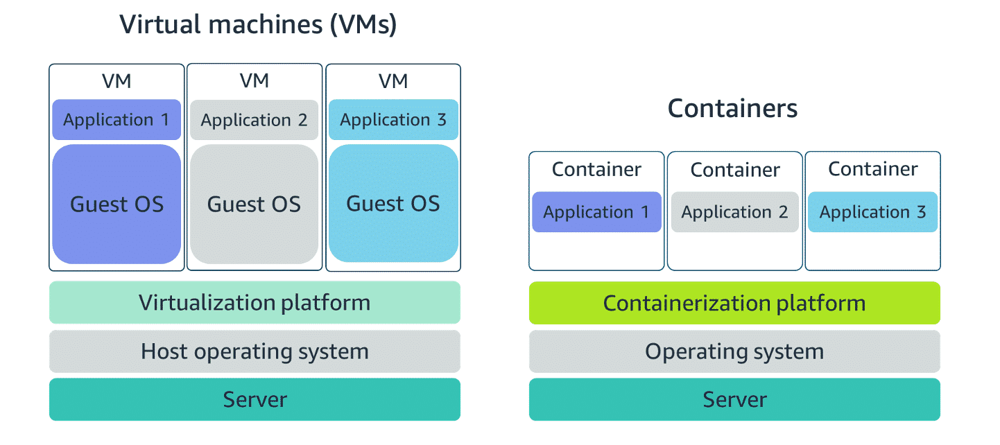
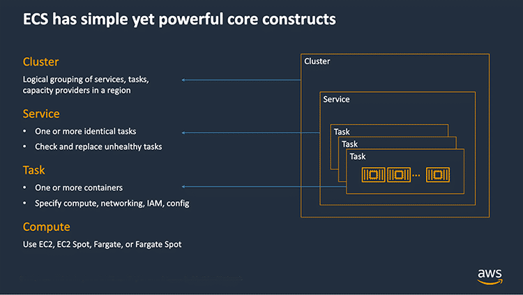
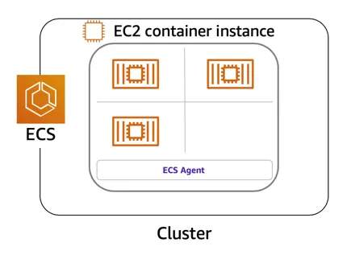

# Containers

A **container** is a standardized unit that packages an application's **code, dependencies, and configuration** together so the application can run reliably across different environments.

```text
Application
    +
Dependencies
    +
Configuration
    ↓
 Container
```

## Why Containers?

Containers solve the problem of applications behaving differently across environments.

```text
Development → QA/Testing → Production
```

### Key Benefits

- **Portability** – The same container can run in different environments.
- **Consistency** – Application code and dependencies remain packaged together.
- **Lightweight** – Containers use fewer resources than virtual machines.
- **Fast startup** – Containers can start quickly, which is useful when applications need to scale rapidly.

## Docker

**Docker** is a popular containerization platform and container runtime.

It helps developers:

- Create and package containers
- Deploy containers
- Run containers

> **Key idea:** **Docker provides tools for creating, packaging, deploying, and running containers.**

---

# Containers vs Virtual Machines

The main difference is how they use the operating system.



> **Virtualization platform → Hypervisor layer**  
> **Server → Physical computer / hardware**

## Virtual Machine

A **virtual machine (VM)** is a virtual computer with its **own operating system**.

```text
Physical Server
      │
   Hypervisor
      │
  ┌───┴───┐
  VM     VM
  │       │
 OS      OS
  │       │
 App     App
```

Each VM has its own OS, so it requires more resources.

## Container

A **container shares the host operating system and kernel**.

```text
Physical Server
      │
    Host OS
      │
  ┌───┼───┐
  C1  C2  C3
  │   │   │
 App App App
```

Because containers share the host OS/kernel, they are more lightweight than VMs.

## Main Differences

| Virtual Machines | Containers |
|---|---|
| Each VM has its own OS | Containers share the host OS/kernel |
| More resource usage | Less resource usage |
| Heavier | Lightweight |
| Slower startup | Very fast startup |
| Complete OS environment | Isolated application environment |

> **Key idea:** **VMs virtualize machines, while containers package applications and their dependencies in a lightweight isolated environment.**

---

# Orchestrating Containers

Containers can run on **EC2 instances**. Running a few containers on one instance is simple, but maintaining **high availability and scalability** becomes more difficult as the workload grows.

At scale, containers may run across multiple EC2 instances and **Availability Zones**.

```text
                    Cluster
               ┌──────┼──────┐
               ↓      ↓      ↓
              EC2    EC2    EC2
             /  \   /  \   /  \
            C1  C2 C3  C4 C5  C6
```

## Why Container Orchestration?

At large scale, you need to manage:

- **Container placement** – Which container should run on which instance?
- **Container failures** – What happens if a container fails?
- **Instance failures** – What happens if an EC2 instance fails?
- **Deployments** – How do you manage and monitor deployments?

**Container orchestration** is the coordination and management of containers running across multiple compute resources.

AWS provides two container orchestration services:

```text
Container Orchestration
          │
      ┌───┴───┐
      ↓       ↓
     ECS     EKS
```

---

# Managing Containers with Amazon ECS

## 1. What is Amazon ECS?

**Amazon ECS (Elastic Container Service)** is an AWS service used to **run and manage containers at scale**.


<p><strong>It helps you:</strong></p>

<ul>
  <li>Start and stop containers</li>
  <li>Handle container failures</li>
  <li>Place containers on available compute resources</li>
  <li>Scale containers</li>
  <li>Manage availability</li>
</ul>

<br clear="left">

---

## 2. What is an ECS Cluster?

An **ECS cluster** is a logical grouping of the **compute resources and ECS workloads** used to run containers.

It provides the environment where ECS runs and manages **tasks and services**.

With EC2 as the compute option:

```text
ECS Cluster
│
├── EC2 Instance 1
│     ├── Container
│     └── Container
│
├── EC2 Instance 2
│     ├── Container
│     └── Container
│
└── EC2 Instance 3
      └── Container
```

> **Cluster = The environment where ECS workloads run.**

---

## 3. What is a Task Definition?

A **task definition** is a **blueprint that tells ECS how to run your container(s)**.

It is a **JSON text file** that describes one or more containers and the resources they need.

It can define:

- **Container image**
- **CPU**
- **Memory**
- **Ports**
- **Storage**
- **Networking information**

> **Task Definition = Blueprint for running containers.**

---

## 4. What is a Task?

A **task** is a **running instance created from a task definition**.

A task represents the actual workload that ECS starts using the configuration in the task definition.

A task can contain **one or more containers**:

```text
Task
│
├── Container 1 → Application
└── Container 2 → Logging / Helper
```

> **Task Definition = Blueprint**  
> **Task = Running instance based on that blueprint**

---

## 5. What is an ECS Service?

An **ECS service** is a configuration that keeps a **specified number of tasks running**.

For example, if the desired count is 3:

```text
Service
  │
  ├── Task 1
  ├── Task 2
  └── Task 3
```

If a task fails, ECS can replace it to maintain the desired number of tasks.

> **Service = Maintains the required number of tasks.**

---

## 6. How ECS Components Work Together



```text
Task Definition
      ↓
    Tasks
      ↓
  Container(s)
      ↓
 Application
```

The service maintains the desired number of tasks inside the cluster:

```text
ECS Cluster
     │
   Service
     │
  ┌──┼──┐
  ↓  ↓  ↓
Task Task Task
 ↓   ↓   ↓
Container(s)
     ↓
 Application
```

---

# Running ECS Tasks on EC2

## 7. What is an ECS Container Instance?

An **ECS container instance** is an **EC2 instance that has the ECS container agent installed and configured**.

It provides the compute environment where ECS containers can run.



> **EC2 Instance + ECS Container Agent = ECS Container Instance**

---

## 8. What is the ECS Container Agent?

The **ECS container agent** is software that runs on an EC2 container instance and **communicates with the Amazon ECS service**.

It provides ECS with information about the cluster and containers, such as:

- What is running on the instance
- Container state
- Cluster management information

```text
Amazon ECS
     ↕
 ECS Agent
     ↕
ECS Container Instance
      (EC2)
     ↓
 Containers
```

> **ECS Agent = Communication link between ECS and the EC2 instance.**

---

# ECS Compute Options

ECS can run tasks using either **EC2** or **Fargate**.

## 9. ECS with EC2

With **ECS + EC2**, ECS tasks and services run on **EC2 instances that you manage**.

```text
Amazon ECS
    ↓
  Cluster
    ↓
EC2 Instances
    ↓
Containers
```

You manage the underlying EC2 infrastructure, while ECS manages the containers.

> **ECS + EC2 → You manage the servers.**

---

## 10. ECS with Fargate

**AWS Fargate** is a **serverless compute option for running ECS tasks and services without managing the underlying servers yourself**.

```text
Amazon ECS
    ↓
 Fargate
    ↓
Containers
```

AWS manages the underlying compute infrastructure, while you focus on the containers and their configuration.

> **ECS + Fargate → AWS manages the underlying compute.**

**Serverless does not mean that servers do not exist.** It means you do not have to manage the underlying servers yourself.

## ECS + EC2 vs ECS + Fargate

| ECS + EC2 | ECS + Fargate |
|---|---|
| You manage EC2 instances | AWS manages the underlying compute |
| More infrastructure control | Less infrastructure management |
| You manage server capacity | You specify the resources your tasks need |
| Tasks run on your EC2 infrastructure | Tasks run using Fargate |

---

# Using Kubernetes with Amazon EKS

## 11. What is Kubernetes?

**Kubernetes** is a **portable, extensible, open-source platform** used to manage and orchestrate **containerized workloads and services**.

It provides a standard way to deploy, manage, scale, and operate containers across different environments.

## 12. What is Amazon EKS?

**Amazon EKS (Elastic Kubernetes Service)** is a **managed Kubernetes service** provided by AWS.

It allows you to run Kubernetes workloads on AWS without manually installing, operating, and maintaining the **Kubernetes control plane**.

EKS can be useful when you already use Kubernetes and want to run those workloads in the AWS Cloud.

## ECS vs EKS

Both provide container orchestration, but they use different technologies:

| Amazon ECS | Amazon EKS |
|---|---|
| AWS-native container orchestration | Managed Kubernetes service |
| Uses ECS | Uses Kubernetes |
| Running unit is a **Task** | Workloads run inside **Pods** |
| EC2 machine is an **ECS Container Instance** | Machine is a **Worker Node / Kubernetes Node** |
| EC2 Container Instance uses the **ECS Agent** | Worker Nodes run **Kubernetes Pods** |

### Important EKS Terms

- **Worker Node** → A machine used by Kubernetes to run workloads. It can be an EC2 instance.
- **Pod** → The smallest deployable unit in Kubernetes. A pod contains one or more containers.

### Why Use EKS?

EKS is useful when you want to use **Kubernetes on AWS** while AWS manages the Kubernetes control plane.

It provides:

- **Simplicity** → AWS manages the Kubernetes control plane.
- **High availability** → EKS provides a managed, highly available Kubernetes control plane.
- **Fine-grained control** → Kubernetes provides detailed control over how workloads are deployed and managed.
- **Portability** → Kubernetes workloads can be moved between different Kubernetes environments with fewer changes.

---

# Quick Revision

| Concept | Meaning |
|---|---|
| **Container** | Packages application code, dependencies, and configuration |
| **Docker** | Platform/runtime for creating and running containers |
| **Container orchestration** | Coordinates and manages containers across compute resources |
| **ECS** | AWS-native container orchestration service |
| **EKS** | Managed Kubernetes service on AWS |
| **Cluster** | Environment where ECS workloads run |
| **Task Definition** | Blueprint for running ECS containers |
| **Task** | Running ECS workload created from a task definition |
| **Service** | Maintains the desired number of ECS tasks |
| **Container Instance** | EC2 instance with the ECS Agent |
| **ECS Agent** | Communicates between ECS and an EC2 container instance |
| **Fargate** | Serverless compute option for ECS tasks |
| **Worker Node** | Machine used by Kubernetes to run workloads |
| **Pod** | Smallest deployable unit in Kubernetes; contains one or more containers |

> **Remember:**
>
> **ECS = AWS-native container orchestration**
>
> **EKS = Managed Kubernetes on AWS**
>
> **ECS + EC2 = You manage the servers**
>
> **ECS + Fargate = AWS manages the underlying compute**
