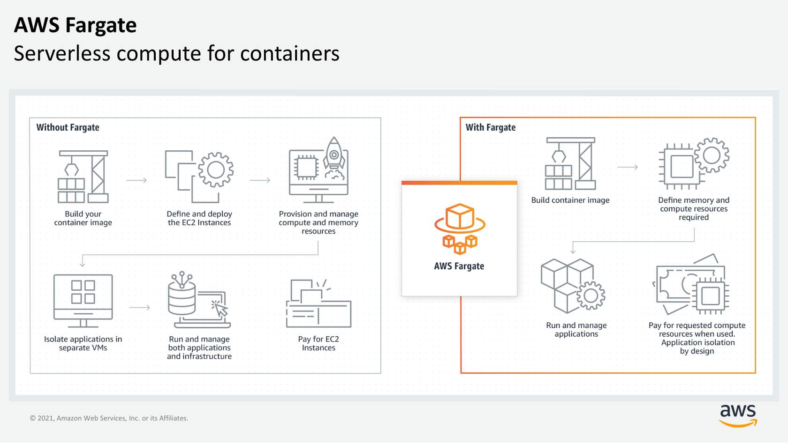

# AWS Fargate

## What is AWS Fargate?

**AWS Fargate** is a **serverless compute engine for containers**.

It provides the compute resources required to run containers while **AWS manages the underlying compute infrastructure**.



> **Key idea:** Fargate lets you run containers **without provisioning or managing the underlying EC2 instances**.

---

## ECS/EKS vs Fargate

| Service | Main responsibility |
|---|---|
| **ECS** | Container orchestration |
| **EKS** | Kubernetes container orchestration |
| **Fargate** | Serverless compute for containers |
| **EC2** | Compute that you manage |

Fargate works with both:

```text
ECS + Fargate
```

and

```text
EKS + Fargate
```

### Important distinction

```text
ECS / EKS
     ↓
Container orchestration
     ↓
EC2 or Fargate
     ↓
Compute for containers
```

> **ECS/EKS = How containers are orchestrated**  
> **EC2/Fargate = Where the container gets compute**

---

# ECS + EC2 vs ECS + Fargate

## ECS + EC2

With ECS running on EC2, you still manage the underlying EC2 infrastructure.

```text
ECS
 ↓
EC2 Instances        ← You manage
 ↓
Containers
 ↓
Application
```

You are responsible for:

- Choosing EC2 instance types
- Provisioning EC2 instances
- Managing EC2 instances
- Managing cluster capacity
- Scaling the EC2 infrastructure

## ECS + Fargate

With Fargate, AWS manages the underlying compute infrastructure.

```text
ECS
 ↓
Fargate              ← AWS manages compute
 ↓
Containers
 ↓
Application
```

You focus mainly on:

- Container images
- Task definitions
- Containers and applications

You do **not** need to choose or manage the underlying EC2 capacity.

---

# What Does Fargate Remove?

Without Fargate, running containers on ECS + EC2 involves infrastructure management:

```text
Build container image
        ↓
Define ECS task
        ↓
Choose EC2 instance type
        ↓
Launch/manage EC2 instances
        ↓
Manage cluster capacity
        ↓
Scale EC2 infrastructure
        ↓
Run containers
```

With Fargate:

```text
Build container image
        ↓
Define ECS task
        ↓
Run task on Fargate
        ↓
Container runs
```

> **Fargate removes the need to provision and manage the EC2 infrastructure underneath your containers.**

---

# Fargate Abstracts the EC2 Instance

**Fargate abstracts the EC2 instance**. This does not mean that servers no longer exist.

It means **you don't have to choose, provision, or manage the underlying compute infrastructure**.

```text
You specify:
CPU + Memory requirements
          ↓
       Fargate
          ↓
AWS provides the required compute
          ↓
      Container runs
```

---

# Allocating the Right Amount of Compute

With EC2, you need to think about instance types and capacity:

```text
t3.micro
t3.small
t3.medium
t3.large
...
```

You also need to determine how many instances are required.

With Fargate, you specify the compute requirements for the task, and Fargate manages the underlying infrastructure needed to provide that compute.

> **Key idea:** You specify the container's compute requirements instead of managing a fleet of EC2 instances.

---

# Scaling and Infrastructure Management

Suppose an application needs:

```text
Normal traffic  → 3 containers
Heavy traffic   → 20 containers
```

With an EC2-based setup, there must be enough EC2 capacity to run those containers.

```text
EC2 #1 → Containers
EC2 #2 → Containers
EC2 #3 → Containers
...
EC2 #N → Containers
```

With Fargate:

```text
ECS
 ↓
Desired container count
 ↓
Fargate
 ↓
AWS-managed compute
 ↓
Containers run
```

Fargate manages the underlying compute infrastructure required for the containers.

> **You focus on the containers and applications, rather than the servers.**

---

# Same ECS Concepts with Fargate

Using Fargate does **not** mean learning a completely different ECS system.

You still use the same ECS concepts, APIs, and AWS integrations.

```text
Cluster
   ↓
Task Definition
   ↓
Task
   ↓
Container
```

The main difference is **who manages the underlying compute**.

```text
                 ECS
                  │
        ┌─────────┴─────────┐
        ↓                   ↓
      EC2                 Fargate
        │                   │
   You manage          AWS manages
   infrastructure      infrastructure
```

---

# Fargate + IAM

Fargate natively integrates with **AWS Identity and Access Management (IAM)**.

This allows workloads to use AWS permissions to access required AWS resources.

```text
Container
    ↓
IAM permissions
    ↓
AWS resources
```

> Use appropriate permissions so workloads have only the access they require.

---

# Fargate + VPC

Fargate natively integrates with **Amazon VPC**.

This allows Fargate containers to run inside your network and lets you control their connectivity to applications and other AWS resources.

```text
                VPC
        ┌───────────────────┐
        │                   │
        │     Fargate       │
        │     Container     │
        │         ↓         │
        │    Application    │
        │                   │
        └───────────────────┘
```

> **Key idea:** Fargate containers can run inside your VPC while you control network connectivity.

---

# Workload Isolation

Fargate provides **workload isolation** and improved security by design while AWS manages the underlying compute environment.

```text
You manage:
Container + Application
        ↓
Fargate
        ↓
AWS manages underlying compute
```

---

# EKS + Fargate

The same idea applies to EKS:

```text
EKS + EC2
   ↓
You manage worker-node infrastructure
```

```text
EKS + Fargate
   ↓
AWS manages underlying compute
```

So Fargate is not limited to ECS.

---

# Key Comparison

| | ECS + EC2 | ECS + Fargate |
|---|---|---|
| Container orchestration | ECS | ECS |
| Container compute | EC2 | Fargate |
| Choose EC2 instance types | **You** | **No** |
| Manage EC2 instances | **You** | **AWS** |
| Manage cluster capacity | **You** | **AWS** |
| Focus on containers | Yes | **More** |
| Serverless | No | **Yes** |

---

# ECS/EKS vs Fargate — Quick Classification

```text
ECS
 ↓
AWS container orchestration

EKS
 ↓
Kubernetes container orchestration

EC2
 ↓
Compute infrastructure that you manage

Fargate
 ↓
Serverless compute for containers
```

### Mental Model

```text
ECS / EKS
     ↓
"How are my containers managed?"
     ↓
Container orchestration

EC2 / Fargate
     ↓
"Where does my container get compute?"
     ↓
Compute
```