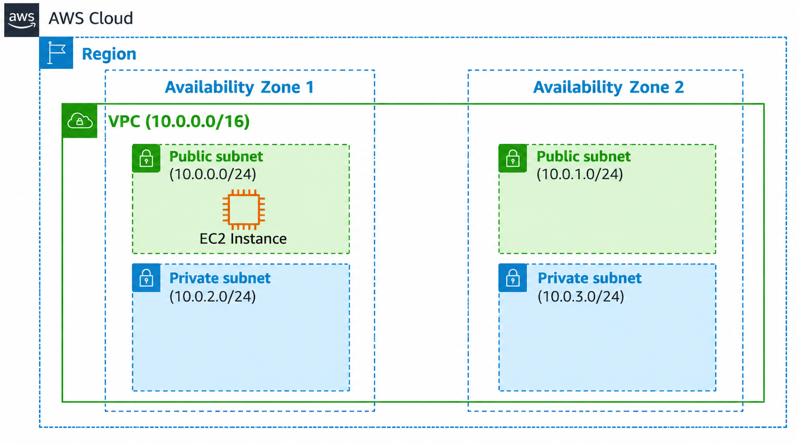
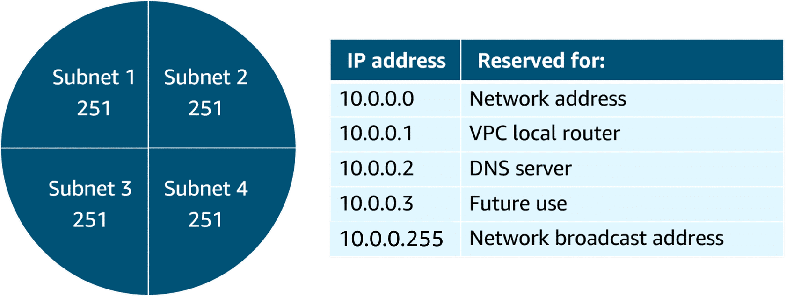
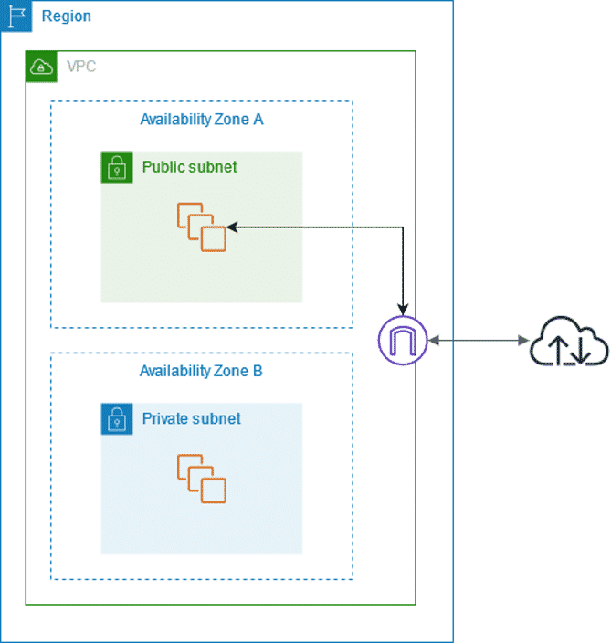
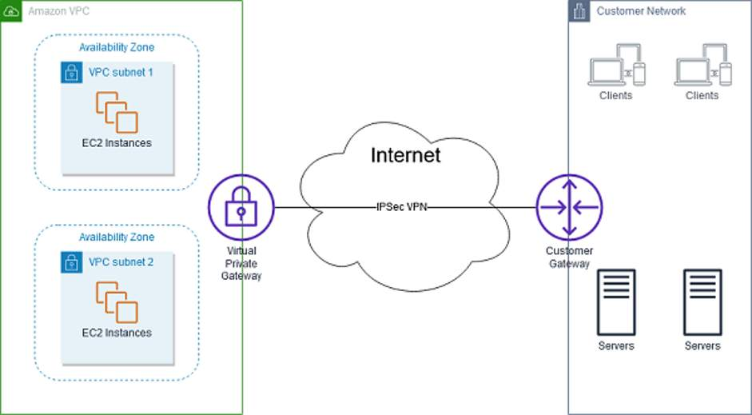
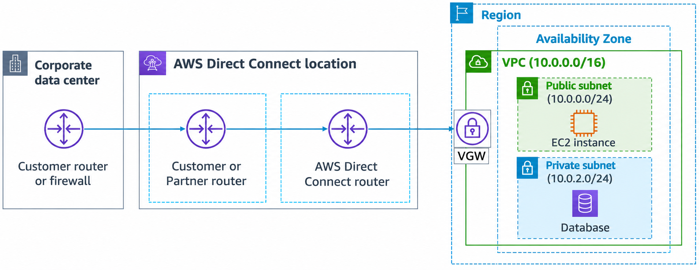

# Amazon VPC — Notes

## 1. What is Amazon VPC?

**Amazon VPC (Virtual Private Cloud)** is an isolated network that you create in the AWS Cloud, similar to a traditional network in a data center.

When creating a VPC, you choose:

1. **VPC name**
2. **Region** — the Region where the VPC will exist
3. **IP range (CIDR)** — determines the size of the network

A VPC spans all Availability Zones in the selected Region.

### VPC CIDR

According to the course, a VPC can have up to **five IPv4 CIDRs**:

- 1 primary CIDR
- Up to 4 secondary CIDRs

Each range can be between **`/28` and `/16`**.

```text
AWS Region
│
├── Availability Zone 1
├── Availability Zone 2
└── Availability Zone 3
        │
        └── VPC spans the Region
```

---

## 2. Subnets

A **subnet** is a smaller network inside a VPC.

```text
VPC
10.0.0.0/16
│
├── Subnet 1
│   10.0.0.0/24
│
└── Subnet 2
    10.0.1.0/24
```

When creating a subnet, specify:

- **VPC** — the VPC in which the subnet exists
- **Availability Zone** — the AZ where the subnet exists
- **IPv4 CIDR block** — the subnet's IP range

The subnet CIDR must be a **subset of the VPC CIDR**.

> **Important:** A subnet belongs to **one Availability Zone**.

When an EC2 instance is launched into a subnet, it is therefore launched in that subnet's Availability Zone.

```text
Region
│
├── AZ-1
│   └── Subnet-A
│       └── EC2
│
└── AZ-2
    └── Subnet-B
        └── EC2
```

---

## 3. Public and Private Subnets

### Public subnet

Used for resources that need internet connectivity.

```text
Internet
   │
   ↓
Public Subnet
   │
   ↓
Resource
```

### Private subnet

Used for resources that should not be directly connected to the internet.

```text
Private Subnet
      │
      ↓
   Resource
```

> **Key idea:** Public and private subnets provide different connectivity options for resources.

---

## 4. High Availability with a VPC

For **redundancy and fault tolerance**, use at least **two subnets in two different Availability Zones**.

```text
                 VPC
                  │
          ┌───────┴───────┐
          │               │
         AZ-1            AZ-2
          │               │
      Subnet-A         Subnet-B
          │               │
        EC2-A           EC2-B
```

If one Availability Zone fails, resources in another AZ can provide backup capacity.

> **Mental model:** Multiple AZs → redundancy → better fault tolerance.

---

## 5. Reserved IP Addresses

AWS reserves **five IP addresses in every subnet** for purposes such as:

- Routing
- DNS
- Network management

For a `/24` subnet:


```text
256 total IP addresses
- 5 reserved by AWS
-------------------
251 usable IP addresses
```

### Course example

A VPC with:

```text
10.0.0.0/22
```

contains:

```text
1,024 total IP addresses
```

It can be divided into four `/24` ranges:

```text
10.0.0.0/24
10.0.1.0/24
10.0.2.0/24
10.0.3.0/24
```

Each `/24` has:

```text
256 total
- 5 reserved
-----------
251 usable
```

The course mentions a common starting design:

```text
VPC     → /16
Subnets → /24
```

This provides a large number of addresses at both levels.

---

# 6. Gateways

A gateway provides a path for communication between networks.

The two gateways covered here are:

| Gateway | Purpose |
|---|---|
| **Internet Gateway** | Connects a VPC to the internet |
| **Virtual Private Gateway** | Connects a VPC to another private network through VPN |

---

## 7. Internet Gateway

An **Internet Gateway (IGW)** allows a VPC to communicate with the internet.




```text
Internet
    │
    ↓
Internet Gateway
    │
    ↓
   VPC
```

You create an Internet Gateway and **attach it to the VPC**.

The course compares it to a home modem:

```text
Home:
Computer → Modem → Internet

AWS:
VPC → Internet Gateway → Internet
```

An Internet Gateway is **highly available and scalable**.

> **Remember:** Internet Gateway = **VPC ↔ Internet**

---

## 8. Virtual Private Gateway

A **Virtual Private Gateway (VGW)** connects your VPC to **another private network** using an **encrypted VPN connection**.



The important idea is that it is for connecting AWS to a private network, such as an on-premises company network.

### VPN architecture

```text
Your side                         AWS side

Private Network                    VPC
     │                              │
     ↓                              ↓
Customer Gateway <── VPN ──> Virtual Private Gateway
```

### Customer Gateway

A **Customer Gateway** represents the device or software on **your side** of the connection.

It can be:

- A physical network device
- A software application

### Virtual Private Gateway

The **Virtual Private Gateway** is the **AWS-side anchor** attached to your VPC.

So:

```text
Customer Gateway
      ↓
Your private network

Virtual Private Gateway
      ↓
AWS VPC
```

An encrypted VPN connection is established between the two sides.

### Easy mental model

> **Virtual Private Gateway = AWS side of a VPN connection to your private network.**

---

## 9. Virtual Private Gateway — Example

Suppose a company has:

```text
Company Office
10.50.0.0/16
```

and an AWS VPC:

```text
AWS VPC
10.0.0.0/16
```

They want systems in the office to communicate securely with AWS resources.

```text
Company Office
      │
      ↓
Customer Gateway
      │
      │ Encrypted VPN
      ↓
Virtual Private Gateway
      │
      ↓
AWS VPC
      │
      ↓
AWS Resources
```

The important point is:

> **Virtual Private Gateway provides the AWS-side endpoint/anchor for the VPN connection.**

---

# 10. AWS Direct Connect

**AWS Direct Connect** provides a **secure physical connection** between your on-premises data center and AWS.



Your internal network is connected to an AWS Direct Connect location using a **standard Ethernet fiber-optic cable**.

```text
On-Premises Data Center
          │
          │ Dedicated physical connection
          ↓
AWS Direct Connect Location
          │
          ↓
         AWS
          │
          ↓
         VPC
```

Direct Connect allows you to create virtual interfaces to:

- Your VPC
- Public AWS services

### Easy mental model

> **Direct Connect = dedicated physical connection between your network and AWS.**

---

# 11. Virtual Private Gateway vs Direct Connect

This is the most important distinction.

### Virtual Private Gateway

```text
On-Premises Network
       │
Customer Gateway
       │
       │ Encrypted VPN
       ↓
Virtual Private Gateway
       │
       ↓
      VPC
```

**Think:** VPN connection.

### AWS Direct Connect

```text
On-Premises Data Center
       │
       │ Dedicated physical connection
       ↓
AWS Direct Connect
       │
       ↓
      VPC
```

**Think:** Dedicated physical connection.

| | Virtual Private Gateway | AWS Direct Connect |
|---|---|---|
| Main purpose | Connect VPC to private network | Connect on-premises network to AWS |
| Connection | VPN | Dedicated physical connection |
| AWS-side concept | Virtual Private Gateway | Direct Connect |
| Your-side concept | Customer Gateway | On-premises network connection |
| Main mental model | **VPN** | **Physical dedicated link** |

---

# 12. Don't Confuse These Three

```text
Internet Gateway
       ↓
    Internet


Virtual Private Gateway
       ↓
    VPN / Private Network


AWS Direct Connect
       ↓
Dedicated Physical Connection
```

### One-line memory trick

- **Internet Gateway** → VPC ↔ **Internet**
- **Virtual Private Gateway** → VPC ↔ **Private Network through VPN**
- **Direct Connect** → AWS ↔ **On-premises through dedicated physical connection**

---

# 13. Complete VPC Mental Model

```text
                         AWS REGION
                             │
              ┌──────────────┴──────────────┐
              │                             │
             AZ-1                          AZ-2
              │                             │
          Subnet-A                      Subnet-B
              │                             │
             EC2                           EC2
              │                             │
              └──────────── VPC ────────────┘
                             │
                ┌────────────┴─────────────┐
                │                          │
                ↓                          ↓
        Internet Gateway         Virtual Private Gateway
                │                          │
                ↓                          ↓
            Internet                 Private Network
                                           │
                                          VPN
```

Direct Connect is another option for connecting an on-premises network:

```text
On-Premises Data Center
          │
          │ Dedicated physical connection
          ↓
   AWS Direct Connect
          │
          ↓
         VPC
```