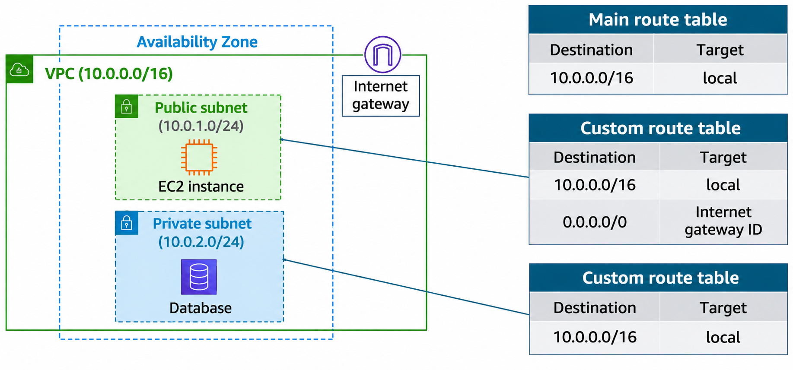

# Amazon VPC Routing — Route Tables

## 1. What Is a Route Table?

A **route table** contains a set of rules called **routes**. These routes determine **where network traffic is directed**.

```text
Traffic
   ↓
Route Table
   ↓
Check destination
   ↓
Choose target
   ↓
Forward traffic
```

Each route has two important parts:

| Field | Meaning |
|---|---|
| **Destination** | The IP range the traffic is trying to reach |
| **Target** | Where AWS should send that traffic |

Example:

```text
Destination     Target
10.0.0.0/16     local
```

This means traffic destined for the VPC's `10.0.0.0/16` network is routed locally within the VPC.

---

## 2. Main Route Table

When you create a VPC, AWS automatically creates a **main route table**.

The main route table is the default route table for the VPC.

AWS assumes that when you create a VPC with subnets, you want traffic to flow between resources and subnets in the local VPC network.

Therefore, the default main route table contains a **local route**:

```text
Main route table

Destination     Target
------------------------
10.0.0.0/16     local
```

For a VPC with CIDR `10.0.0.0/16`, this local route allows communication between resources inside that VPC.

---

## 3. How Subnets Use the Main Route Table

A subnet that does **not** have an explicit route table association uses the **main route table implicitly**.

```text
VPC
 │
 ├── Main Route Table
 │       └── 10.0.0.0/16 → local
 │
 ├── Subnet A ──┐
 │              │
 └── Subnet B ──┘
```

So, by default, subnets can communicate with other resources in the VPC through the local route.

---

## 4. Important Rules About the Main Route Table

According to the course:

### Cannot be deleted

You cannot delete the main route table.

### Gateway route table cannot become the main table

You cannot set a gateway route table as the main route table.

### Can replace the main route table

You can designate a different route table as the main route table.

### Can modify its routes

You can:

- Add routes
- Remove routes
- Modify routes

### Can explicitly associate a subnet with it

A subnet can use the main route table implicitly, but you can also explicitly associate the subnet with the main route table.

---

## 5. Custom Route Tables

The main route table provides the default routing behavior.

However, different subnets may need **different routing rules**.

For example:

```text
Frontend Subnet
      │
      ↓
Database Subnet
```

You may want different routes for different subnets when they need to access resources outside the VPC.

For this, you can create a **custom route table**.

---

## 6. Custom Route Table Association

If you explicitly associate a subnet with a custom route table:

> **That subnet uses the custom route table instead of the main route table.**

Example:

```text
VPC
 │
 ├── Main Route Table
 │       └── 10.0.0.0/16 → local
 │
 ├── Subnet A
 │       └── Uses Main Route Table
 │
 └── Subnet B
         └── Uses Custom Route Table
```

This allows different subnets to have different routing behavior.



---

## 7. Local Route in Every Route Table

When you create a custom route table, AWS automatically adds the **local route**.

Example:

```text
Custom Route Table

Destination     Target
------------------------
10.0.0.0/16     local
```

This allows communication between resources and subnets inside the VPC.

You do not need to manually create this local route.

---

## 8. Adding Internet Access

A custom route table can contain additional routes for traffic that needs to leave the VPC.

For example:

```text
Custom Route Table

Destination     Target
-------------------------------
10.0.0.0/16     local
0.0.0.0/0       Internet Gateway
```

The routes have different purposes:

### Local route

```text
10.0.0.0/16 → local
```

Used for traffic destined for resources inside the VPC.

### Default route

```text
0.0.0.0/0 → Internet Gateway
```

Used for destinations outside the VPC, such as the internet.

---

## 9. Main vs Custom Route Table

| Feature | Main Route Table | Custom Route Table |
|---|---|---|
| Created automatically with VPC | ✅ Yes | ❌ No |
| Used by default | ✅ Yes | ❌ No |
| Can add/remove/modify routes | ✅ Yes | ✅ Yes |
| Contains local route | ✅ Yes | ✅ Yes |
| Can be explicitly associated with subnet | ✅ Yes | ✅ Yes |
| Can provide different routing per subnet | Not by default | ✅ Yes |

---

## 10. Why Use Custom Route Tables?

You may want different subnets to have different routing behavior.

```text
                VPC
                 │
        ┌────────┴────────┐
        │                 │
   Frontend Subnet    Database Subnet
        │                 │
   Custom Route A     Custom Route B
        │                 │
   Different routes   Different routes
```

The course suggests that you can protect your VPC by:

1. Explicitly associating each new subnet with an appropriate custom route table.
2. Leaving the main route table in its original default state.

---

## 11. Complete Mental Model

Think of a route table as a **traffic direction map**.

```text
                Route Table
                     │
          ┌──────────┴──────────┐
          │                     │
    Destination             Target
          │                     │
      "Where?"              "Send to?"
```

Example:

```text
Destination         Target
--------------------------------
10.0.0.0/16         local
0.0.0.0/0           Internet Gateway
```

Meaning:

```text
Traffic for 10.0.0.0/16
        ↓
     Stay inside VPC
        ↓
       local


Traffic for anywhere else
        ↓
   0.0.0.0/0
        ↓
Internet Gateway
```

---

## 12. Main Route Table vs Subnet Association

The key relationship is:

```text
VPC
 │
 ├── Main Route Table
 │       │
 │       └── Used implicitly by subnets
 │           without explicit association
 │
 ├── Subnet A
 │       └── No explicit association
 │               ↓
 │          Uses Main Route Table
 │
 └── Subnet B
         └── Explicit association
                 ↓
           Uses Custom Route Table
```

### Remember

> **No explicit association → Main route table**

> **Explicit association with custom table → Custom route table**

---

## 13. Key Takeaways

- A **route table** contains routes that determine where network traffic is directed.
- Each route has a **destination** and a **target**.
- AWS automatically creates a **main route table** when you create a VPC.
- The main route table contains a **local route** for communication inside the VPC.
- A subnet without an explicit route table association uses the **main route table**.
- You can create **custom route tables** when different subnets need different routing behavior.
- Associating a subnet with a custom route table makes that subnet use the custom table instead of the main table.
- Custom route tables also contain the **local route** automatically.
- Additional routes can point traffic to targets such as an **Internet Gateway**.
- The main route table cannot be deleted.
- You can modify the routes in the main route table and replace which route table is designated as the main one.

---

## One-Line Memory Trick

```text
Route Table = "Where should this traffic go?"

Destination → Target

Main Route Table
→ Default route table for subnets without an explicit association

Custom Route Table
→ Used when a subnet needs different routing rules
```
